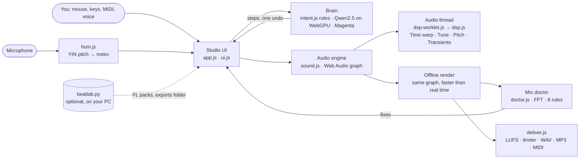

# BeatLab


A free beat studio that runs in your browser and works the way FL Studio works: patterns in a channel rack and piano roll, painted onto a playlist, mixed on a mixer, exported as WAV, MP3 and MIDI. It also comes with its own brain that makes and edits beats from plain sentences, running on your own computer with no account and no AI bill.


Try it in your browser: **https://droolbot.github.io/beatlab/**. How to use it: **[the docs](https://droolbot.github.io/beatlab/docs.html)**.

## What's inside


- **The FL workflow.** Numbered patterns, a channel rack with a step graph, a piano roll you can play, and a free playlist with pattern, audio and automation clips. There's a mixer with inserts, buses and sends, and FL's tools, menus and shortcuts, with a cheat sheet on F1. Two layouts: Rig (one big screen with hardware around it) and DAW (floating, resizable windows, like FL).
- **Built-in instruments.** A sampler, a three-oscillator synth, an FM synth, a wavetable synth, an acid bass with accents and slides, a slicer, and 808 and drum voices, each with presets. Star any plugin to keep it in Favourites.
- **Built-in effects.** 23 of them: parametric EQ, multiband compressor, gate, auto-pan, vocoder, delay, reverb, distortion and more. Every plugin has its own window.
- **Effects on the audio thread.** Four effects run sample by sample in an AudioWorklet:
  - **Time warp:** half-time, stutter, tape stop and reverse, locked to the bar
  - **Tune:** hears the note being sung and pulls it to the song's key
  - **Pitch shifter**
  - **Transient shaper:** more punch or a shorter tail
- **Sounds.** BeatLab ships its own kits (Trap, Drill, Lofi, Boom Bap, House), 808s and loops. If FL Studio is installed, BeatLab also plays FL's own packs from your install, on the website too: multi-sampled instruments, and drum kits with velocity layers.
- **The brain.** Ctrl+K takes requests like "make a drill beat at 142, add 808 slides every 2 bars and hat rolls every 4". It shows the plan, then does it as one undo.
  - It understands the way producers actually type: "the kick is too quiet", "808 not hitting", "i dont like the chords", "make the melody a flute", "sidechain the 808", "make it sad", slang and typos ("mak a trap beat", "louder kik").
  - When it doesn't get something, it offers the closest things it can do, one click each.
  - For drums it uses Google's free Magenta models to humanize, write variations and play fills.
  - An optional smart mode runs a language model inside your browser for sentences the rules don't understand: Fast (Qwen2.5 1.5B, 1 GB) or Best (Qwen2.5 7B, 5 GB, for strong graphics cards).
- **Brain chat** (Ctrl+I). A side panel, like a code editor's AI assistant, that knows your channels, patterns, key and mix.
  - After each request it shows what changed, with **Keep**, **Undo** and **A/B** (hear before and after while it plays).
  - It answers questions about the beat, takes @mentions, and changes only the selected notes when you've selected some.
- **Agent.** “Turn this loop into a full song” builds intro, verse, hook, bridge and outro from one pattern, lays them out, adds a fill and balances the mix, all as one undo.
- **Autocomplete.** Write a few notes or drum steps and pause. The AI suggests what comes next as faint notes: **Tab** keeps them, **Esc** drops them.
- **The mix doctor.** It listens to your beat part by part and scores it out of 100. It checks:
  - the frequency balance against a finished mix
  - the kick fighting the 808
  - low end in parts that don't need it
  - the levels, the stereo, and how squeezed the master is

  Each problem comes in plain words with a one-click fix. On the starter beat, **Fix all** takes it from 33 to 94.
- **Hum it.** Hum or sing a melody into the microphone, and BeatLab writes the notes into the piano roll, in the song's key and on the beat.
- **Finished beats.** Auto mix balances the parts by loudness. Export gives WAV (16, 24 or 32-bit), MP3 at 320 kbps, MIDI for each part, stems, and a loudness report, with mastering to a target LUFS.
- **Record.** Mic, MIDI keyboard, pads and the computer keyboard all play the selected sound and can record into patterns.
- **On your phone.** On phones, tablets and small laptops the studio shows one screen at a time, GarageBand-style:
  - a tab bar with Song, Beat, Keys, Mix and Make
  - full-screen channel windows
  - menus that slide up from the bottom


## Get it running (Windows)

1. Download this repository (green **Code** button, then **Download ZIP**) and unzip it anywhere.
2. Double-click **Install BeatLab.bat**. It checks for Python (and offers to install it), then puts a BeatLab shortcut on your Desktop and in the Start menu.
3. Double-click **BeatLab** on your Desktop. Your browser opens the studio. Use Chrome or Edge.

To stop BeatLab, close its small black window. Your beats save in the browser as you work, and exports land in the `exports` folder next to BeatLab.

Optional: some FL Studio samples need ffmpeg to play. To install it, run `winget install Gyan.FFmpeg`.

## The website version

https://droolbot.github.io/beatlab/ is the whole studio, song search included, with nothing to install. Use Chrome or Edge.

**FL Studio's sounds on the website.** Open **Sounds**, press **Connect FL Studio** and pick FL's Packs folder: `C:\Program Files\Image-Line\FL Studio 2025\Data\Patches\Packs`. Chrome calls it uploading, but the sounds stay on your computer; the page reads them from there. Your FL instruments and kits then work as they do in the download.

A few differences from the downloaded version:

- The browser forgets the FL folder when you close the page, so you connect it again next visit. Beats keep their FL sounds and get them back once it's connected.
- Exports download as one zip, instead of landing in the `exports` folder.
- The handful of FL samples that need ffmpeg won't play.

The `beatlab/` folder is the website. Every push to `main` republishes it through `.github/workflows/pages.yml`, after the unit tests pass.

## The smart brain

Typed commands work instantly and offline. Smart mode downloads a model once: Fast is about 1 GB, Best is about 5 GB and needs a graphics card with about 6 GB of memory (if yours can't hold it, BeatLab switches back to Fast by itself). To turn it on, open the menu next to **Make a beat** and pick **Smart brain for anything it doesn't know**, or **Best smart brain**. You can also type "smart brain" after Ctrl+K, or press **Ask the smart brain instead** in the chat when the brain doesn't get something. It needs WebGPU, which current Chrome and Edge have on most Windows PCs. After the first download, it runs offline.

## How it's built



- **No build step and no framework:** plain ES modules, in any modern browser.
- **The maths is separate from the browser.** The sample-by-sample DSP, the mix doctor, humming, the brain's language and the music engine are pure modules. The same code runs on the audio thread and in the Node tests.
- **Live and offline sound the same.** Playback, exports, stems, auto mix and the mix doctor all render through one engine.
- **Everything is local.**
  - The AI runs in your browser: rules, Magenta, and an optional Qwen2.5 model on WebGPU.
  - Beats are saved in IndexedDB on your computer.
  - The only outside requests are Apple's song previews and the libraries' CDN.

## For developers

No build step: plain ES modules, served by `beatlab.py` (Python standard library only).

```bash
npm test
```

That runs the unit tests:
- syntax checks for every module
- the music engine, note tools and instrument zoning
- the brain's 72 phrasings, and 190 requests typed the way producers type them (`beatlab/brain_eval.mjs`, which fails below 95%)
- the DSP, measured on test signals: half-time halves the pitch, Tune pulls a sharp A back to 220 Hz
- every mix doctor rule, on mixes built with one known problem each
- humming to notes

```bash
npm run test:studio
```

That runs the end-to-end suite, which drives the studio in headless Chrome with real mouse and keyboard input. Start `python beatlab.py --no-browser` first. Several tests play FL Studio's packs, so run the suite on a PC with FL Studio installed. Set `CHROME`, `BEATLAB_URL` or `BEATLAB_TEST_DIR` if your paths differ.

```bash
npm run samples
```

That re-renders BeatLab's own sample library from its synths, into `beatlab/samples/BeatLab`.

| File | What it does |
| --- | --- |
| `beatlab.py` | Local server: the studio, exports to the `exports` folder, FL pack access |
| `beatlab/studio.html`, `app.js` | The studio UI |
| `beatlab/sound.js` | Audio engine, instruments, effects, mixer, automation |
| `beatlab/music.js` | Styles, patterns, grooves |
| `beatlab/instruments.js` | Sample instruments and kits, pitch detection |
| `beatlab/intent.js`, `brain.js` | The brain: sentences to steps, Magenta, the local language model |
| `beatlab/deliver.js` | Loudness, limiter, WAV, MP3, MIDI, zip |
| `beatlab/dsp.js`, `dsp-worklet.js` | Sample-by-sample effects, and the AudioWorklet that runs them |
| `beatlab/doctor.js` | The mix doctor: spectrum, the rules, the fixes |
| `beatlab/hum.js` | Humming or singing to notes |
| `beatlab/index.html`, `landing.js` | The landing page |


## Credits

These libraries load from jsDelivr when they're first needed:

| Library | Licence |
| --- | --- |
| [three.js](https://threejs.org) | MIT |
| [Magenta.js](https://github.com/magenta/magenta-js) and its MusicVAE / GrooVAE checkpoints | Apache-2.0 |
| [WebLLM](https://github.com/mlc-ai/web-llm) | Apache-2.0 |
| [Qwen2.5-1.5B-Instruct](https://huggingface.co/Qwen/Qwen2.5-1.5B-Instruct) and [Qwen2.5-7B-Instruct](https://huggingface.co/Qwen/Qwen2.5-7B-Instruct) | Apache-2.0 |
| [lamejs](https://github.com/zhuker/lamejs) | LGPL-3.0 |
| Anton, Space Grotesk, IBM Plex Mono, Geist (Google Fonts) and DSEG7 | SIL Open Font License |

Song previews come from Apple's iTunes Search API (30-second previews only). BeatLab's sample library was made with BeatLab's own synths. The turntable model is the author's own.

BeatLab itself is MIT licensed: see [LICENSE](LICENSE).

FL Studio is a trademark of Image-Line. BeatLab isn't affiliated with or endorsed by Image-Line, and it includes none of their software or samples.
