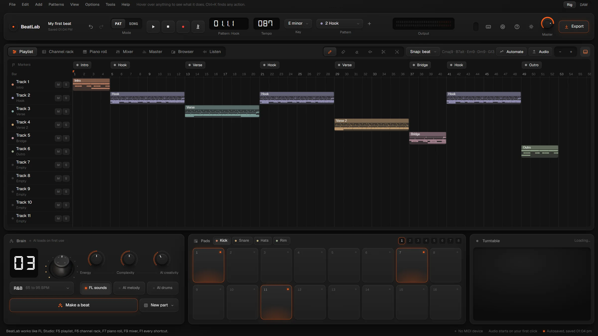
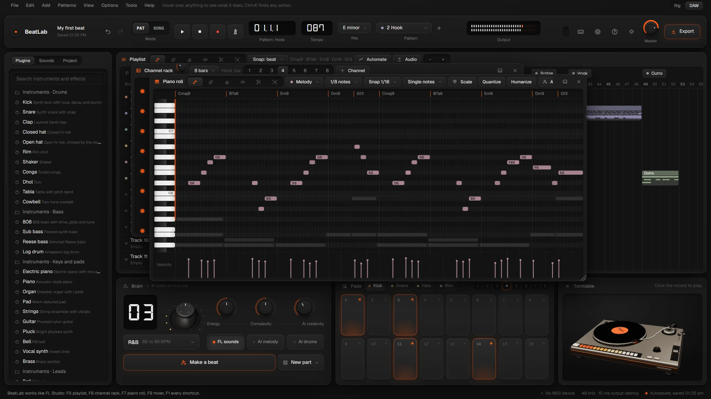

# BeatLab


A free beat studio that runs in your browser and works the way FL Studio works: patterns in a channel rack and piano roll, painted onto a playlist, mixed on a mixer, exported as WAV, MP3 and MIDI. It also comes with its own brain that makes and edits beats from plain sentences, running on your own computer with no account and no AI bill.


Try it in your browser: **https://droolbot.github.io/beatlab/**

## What's inside




- **The FL workflow.** Numbered patterns, a channel rack with a step graph, a piano roll you can play, and a free playlist with pattern, audio and automation clips. There's a mixer with inserts, buses and sends, and FL's tools, menus and shortcuts, with a cheat sheet on F1. Two layouts: Rig (one big screen with hardware around it) and DAW (floating, resizable windows, like FL).
- **Built-in instruments.** A sampler, a three-oscillator synth, an FM synth, a wavetable synth, a slicer, and 808 and drum voices, each with presets.
- **Built-in effects.** Parametric EQ, multiband compressor, gate, auto-pan, vocoder, delay, reverb, distortion and more. Every plugin has its own window.
- **Sounds.** BeatLab ships its own kits (Trap, Drill, Lofi, Boom Bap, House), 808s and loops. If FL Studio is installed, BeatLab also plays FL's own packs from your install: multi-sampled instruments, and drum kits with velocity layers.
- **The brain.** Ctrl+K takes requests like "make a drill beat at 142, add 808 slides every 2 bars and hat rolls every 4". It shows the plan, then does it as one undo. For drums it uses Google's free Magenta models to humanize, write variations and play fills. An optional smart mode runs a small language model (Qwen2.5 1.5B) inside your browser to understand sentences the rules don't.
- **Finished beats.** Auto mix balances the parts by loudness. Export gives WAV (16, 24 or 32-bit), MP3 at 320 kbps, MIDI for each part, stems, and a loudness report, with mastering to a target LUFS.
- **Record.** Mic, MIDI keyboard, pads and the computer keyboard all play the selected sound and can record into patterns.



## Get it running (Windows)

1. Download this repository (green **Code** button, then **Download ZIP**) and unzip it anywhere.
2. Double-click **Install BeatLab.bat**. It checks for Python (and offers to install it), then puts a BeatLab shortcut on your Desktop and in the Start menu.
3. Double-click **BeatLab** on your Desktop. Your browser opens the studio. Use Chrome or Edge.

To stop BeatLab, close its small black window. Your beats save in the browser as you work, and exports land in the `exports` folder next to BeatLab.

Optional: some FL Studio samples need ffmpeg to play. To install it, run `winget install Gyan.FFmpeg`.

## The website version

The `beatlab/` folder also works as a plain website. Pushing to `main` puts it on GitHub Pages through `.github/workflows/pages.yml`. To turn that on, open the repository's **Settings → Pages** and set the source to **GitHub Actions**.

The website version has everything except the parts that need the local server:

- FL Studio's sounds (it uses BeatLab's own kits instead)
- song search
- saving straight to the `exports` folder (exports download as one zip instead)

## The smart brain

Typed commands work instantly and offline. Smart mode downloads a roughly 1 GB model once. To turn it on, open the menu next to **Make a beat** and pick **Smart brain for anything it doesn't know**, or type "smart brain" after Ctrl+K. It needs WebGPU, which current Chrome and Edge have on most Windows PCs. After the first download, it runs offline.

## For developers

No build step: plain ES modules, served by `beatlab.py` (Python standard library only).

```bash
npm test
```

That runs the unit tests: syntax checks for every module, the music engine, note tools, instrument zoning, and the brain's 55 phrasings.

```bash
npm run test:studio
```

That runs the end-to-end suite, which drives the studio in headless Chrome with real mouse and keyboard input. Start `python beatlab.py --no-browser` first. Several tests play FL Studio's packs, so run the suite on a PC with FL Studio installed. Set `CHROME`, `BEATLAB_URL` or `BEATLAB_TEST_DIR` if your paths differ.

```bash
npm run samples
```

That re-renders BeatLab's own sample library from its synths, into `beatlab/samples/BeatLab`.

| File | What it does |
| --- | --- |
| `beatlab.py` | Local server: the studio, exports, FL pack access, song previews |
| `beatlab/studio.html`, `app.js` | The studio UI |
| `beatlab/sound.js` | Audio engine, instruments, effects, mixer, automation |
| `beatlab/music.js` | Styles, patterns, grooves |
| `beatlab/instruments.js` | Sample instruments and kits, pitch detection |
| `beatlab/intent.js`, `brain.js` | The brain: sentences to steps, Magenta, the local language model |
| `beatlab/deliver.js` | Loudness, limiter, WAV, MP3, MIDI, zip |
| `beatlab/index.html`, `landing.js` | The landing page |

The plan and what's done are in [ROADMAP.md](ROADMAP.md).

## Credits

These libraries load from jsDelivr when they're first needed:

| Library | Licence |
| --- | --- |
| [three.js](https://threejs.org) | MIT |
| [Magenta.js](https://github.com/magenta/magenta-js) and its MusicVAE / GrooVAE checkpoints | Apache-2.0 |
| [WebLLM](https://github.com/mlc-ai/web-llm) | Apache-2.0 |
| [Qwen2.5-1.5B-Instruct](https://huggingface.co/Qwen/Qwen2.5-1.5B-Instruct) | Apache-2.0 |
| [lamejs](https://github.com/zhuker/lamejs) | LGPL-3.0 |
| Anton, Space Grotesk, IBM Plex Mono, Geist (Google Fonts) and DSEG7 | SIL Open Font License |

Song previews come from Apple's iTunes Search API (30-second previews only). BeatLab's sample library was made with BeatLab's own synths. The turntable model is the author's own.

BeatLab itself is MIT licensed: see [LICENSE](LICENSE).

FL Studio is a trademark of Image-Line. BeatLab isn't affiliated with or endorsed by Image-Line, and it includes none of their software or samples.
